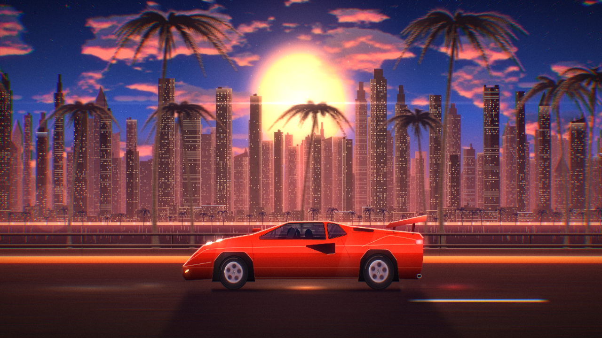

# DRFT

**A drum & bass radio inside Spotify, with a car cruising along a city bay at sunset. A Spicetify extension.**



Install the extension and a **DRFT** button appears at the top of Spotify. Press it, press **LISTEN**: the DRFT playlist plays shuffled, in an endless loop, while a car cruises along the bay at sunset behind the music.

- **Back to Spotify:** **✕ SPOTIFY** at the top right, Esc, or the DRFT button again. The music keeps going and the radio keeps feeding the queue.
- **Play something else** in Spotify and DRFT steps aside, and your shuffle and repeat settings come back as they were. Press play in DRFT to bring the radio back.

No developer account, no Client ID, no login: DRFT uses your Spotify app as it is.

## Install

### From the Marketplace

1. Install [Spicetify](https://spicetify.app/docs/getting-started) and its [Marketplace](https://github.com/spicetify/marketplace).
2. In Spotify, open **Marketplace › Extensions**, search **DRFT**, press **Install**.

### By hand

1. Install [Spicetify](https://spicetify.app/docs/getting-started).
2. Download [`spicetify/dist/drft.js`](spicetify/dist/drft.js) and put it in Spicetify's `Extensions` folder:
   - Windows: `%appdata%\spicetify\Extensions\`
   - macOS / Linux: `~/.config/spicetify/Extensions/`
3. Run:
   ```
   spicetify config extensions drft.js
   spicetify apply
   ```

## The radio

One playlist, picked by DRFT, played by Spotify itself in shuffle and repeat: it never stops, whether DRFT is open or not, and your queue is left alone.

The playlist is the curator's choice: everyone who installs DRFT hears the same selection.

## Visuals

### Sunset (default)

A car cruising along a city bay at sunset, seen from the side, in an endless loop: a big sun between the towers, palm trees and street lights going by, the guardrail and the road rushing past. Everything is drawn live in the page, nothing is a video.

- **Film look.** Contrast-adaptive sharpening for a crisp, upscaled image, bloom and a little red halation around the lights, chromatic aberration toward the edges, an anamorphic streak across the sun, depth of field on the distant city and palms, a soft film curve, vignette and moving grain.
- **The scene.** Dense towers in several hazy layers with small lit windows, lit crowns, water towers, blinking antenna lights and a few windows switching on and off; a starry sky with twinkling stars and the odd shooting star; drifting clouds lit from below; palm trees with ringed trunks, dead fronds and coconuts that sway in the wind; dust floating in the backlight and out-of-focus specks passing in front of the lens.
- **Three cars**, each with see-through windows (driver and seats in silhouette), the horizon and passing lights reflected on the paint, brake discs and calipers behind the spokes, headlights on: a red 80s wedge supercar, a gloss-black Supra MK4 with its hoop wing, a red M3 E36 coupé. Change car with **C** or in Menu › Visuals: the old one speeds off, the new one drives in.
- **Weather.** Clear, Cloudy, Rain, Storm and Fog, with smooth transitions. In AUTO the sky changes on its own every two to four minutes. Rain falls in two layers, splashes on the road and sprays from the wheels; the wet road darkens and reflects the scenery, the lights and the car (it dries slowly once the rain stops); storms bring lightning and wind in the palms; fog swallows the city and widens every halo. Pick a sky with **W** or in Menu › Visuals.

### Night drive (pixel art)

The earlier scene is still there, in Menu › Visuals › Scene › NIGHT DRIVE.

One endless night drive, seen from the driver's seat of a tuned race car, through a wide windshield: low-resolution, softly grained rendering with a colour grade that follows the mood (teal at night), glowing lights, the digital dash with the big gear number, shift lights and lap timer, the wheel and its lit buttons turning with the road, the wiper, the mirror.

- **The road never repeats.** It is generated from a random seed as you drive and moves through expressway (sodium lamps, gantry signs, traffic to overtake), tunnels, mountain pass (tight hairpins, guardrails, cedars, a vending machine glowing at a pull-out), forest, city (neon signs, crossings), suspension bridge over the bay, coast road, and now and then a cyberpunk city: towers covered in pink and cyan neon, huge light boards, overpasses, streets always wet. Curves, hills, speed and gear changes follow the road.
- **Weather.** Rain streaks toward the windshield and the drops climb up the glass as they would at speed, the wiper sweeps them away; snow, fog with headlight beams, storms with lightning. Moods change slowly on their own (Night, Rain, Fog, Sodium, Pink dawn, Dawn, Snow, Storm), each with its own colour grade; lights, neon and car paint keep their colours.
- **Traffic and driving.** Painted cars and trucks to overtake on expressways and in the city, with smooth, anticipated lane changes and blinkers; oncoming headlights on the two-way mountain, forest and coast roads (the car keeps left, as in Japan); nobody ever touches anyone. The driver's eyes follow the corners, the view widens and lights streak as speed builds, an ETC toll now and then, the dazzle when leaving a tunnel, bridges over the city, the sun rising in the Dawn mood.
- **The chase:** on every new track, and now and then along the road, the driver checks behind him: over the right shoulder, over the left shoulder, or a quick glance in the mirror. A police car follows, a little closer each time, red and blue lights turning; their glow sweeps the cabin, the screen and the wet road even while he looks ahead. When it's right behind, he floors it and loses it.
- **Anime moments:** on some mountain hairpins (dry road only), the drive turns into an anime drift: slow motion, a frozen frame with speed lines, then an exaggerated slide with tyre smoke, sparks and tail-light trails in the mirror, and the car accelerates out.
- **The dash:** speed, gear, revs and shift lights (green, orange, red) stay consistent with each other; the lap timer runs over 2.6 km with a live delta against the car's average pace; **DRFT** lights up during slides. A small map screen shows the road ahead as a dotted line, with the other cars, the police behind, and the next toll or tunnel.
- **Lights:** pink and cyan neon in the city, street and tunnel lights that sweep across the cabin, LEDs that glow and breathe.
- **Weather and driving:** in auto mode the weather moves step by step (clear, fog, rain, storm, rain, calm…); the car is slower and more careful in rain and fog, cars ahead throw spray, fog spreads the lights. An optional slow day / night cycle lives in Menu › Visuals (night by default).

## Controls

| Key | Action |
|---|---|
| Space | Play / pause |
| N or → | Next track |
| ← | Previous track |
| L | Favorite |
| C | Next car (Shift+C: previous) |
| W or P | Next sky (Shift: previous); with Night drive, P changes the mood |
| F | Fullscreen |
| M | Menu |
| ↑ ↓ | Volume |
| Esc | Back to Spotify |

The progress bar is a line with a playhead moving in real time: hover it to read the time, drag it to move through the track (or focus it and use ← →, 5 s steps). DRFT's volume is Spotify's volume. **OPEN ↗** on a track opens it in Spotify.

## Notes

- Spicetify modifies the Spotify desktop app, which Spotify's terms don't allow. Install it knowing that.
- Spotify updates sometimes break Spicetify for a few days; run `spicetify apply` again after an update.
- DRFT plays through the Spotify app and never calls Spotify's Web API for playback, so it isn't affected by its rate limits.

## Development

DRFT is one HTML file, [`index.html`](index.html). The extension is built from it:

```
node spicetify/build.mjs
```

- [`spicetify/config.json`](spicetify/config.json): the radio's playlist (its Spotify link).
- [`spicetify/host.js`](spicetify/host.js): runs inside DRFT in Spotify. It gives DRFT the Spotify app's session and player in place of the website's login and Web Playback SDK, and hides the website-only sources.
- [`spicetify/dist/drft.js`](spicetify/dist/drft.js): the built extension, the file the Marketplace installs. Rebuild and commit it after every change.
- [`spicetify/dev/mock.html`](spicetify/dev/mock.html): runs the extension against a fake Spicetify, outside Spotify. Serve the repository over HTTP and open `/spicetify/dev/mock.html#open`.

The Marketplace finds DRFT through the repository topic `spicetify-extensions` and [`manifest.json`](manifest.json).

### The website

`index.html` also runs on its own at [studioobsidienne.github.io/drft](https://studioobsidienne.github.io/drft/), with three sources: a DRFT FM radio built from your own playlist, one of your playlists, or your own WAV files. Its Spotify playback needs Premium and a Spotify developer app of your own (Client ID pasted in the menu, redirect URI `https://studioobsidienne.github.io/drft/`).
